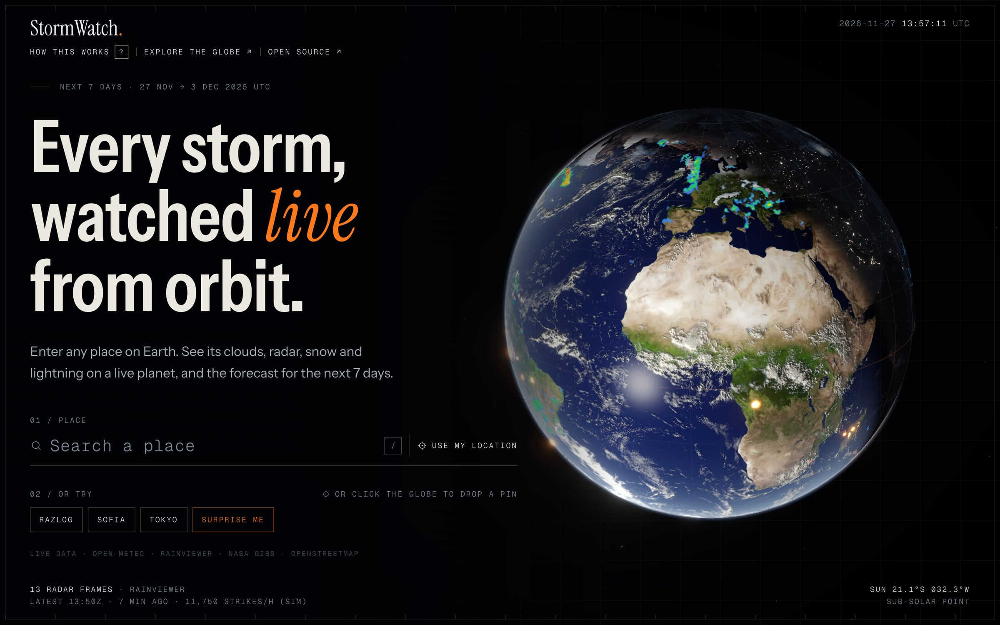
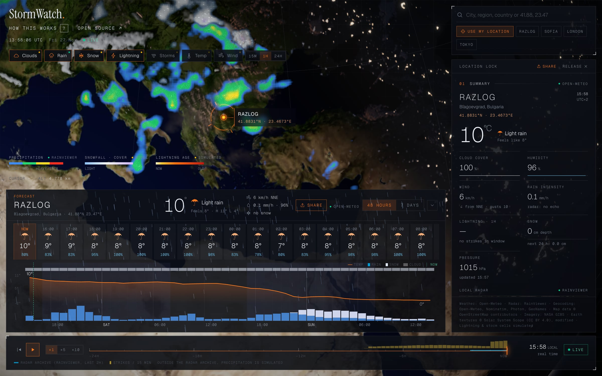
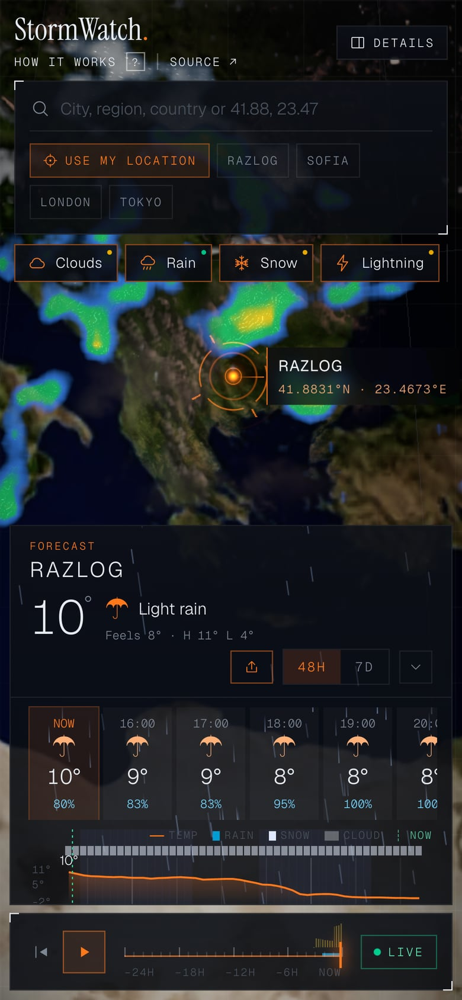
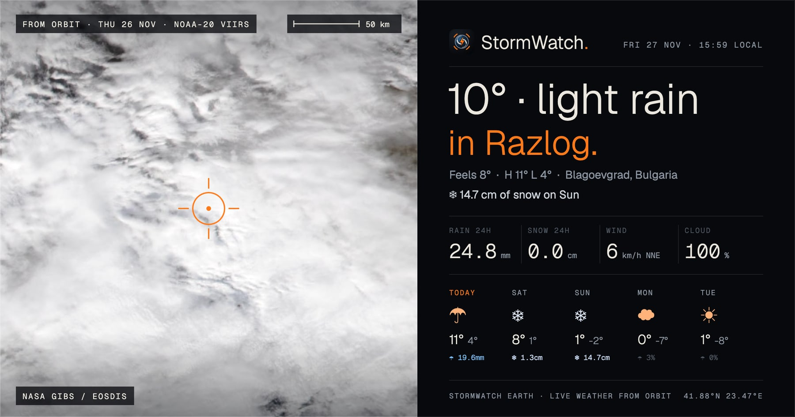

<p align="center">
  <a href="https://stormwatch.earth">
    <picture>
      <source media="(prefers-color-scheme: dark)" srcset="public/brand/wordmark.png">
      
    </picture>
  </a>
</p>

<h3 align="center">Every storm, watched live from&nbsp;orbit.</h3>

<p align="center">
  Pick any place on Earth. StormWatch shows its clouds, radar, snow and lightning on a live 3D planet, and the forecast for the next 7 days.<br>
  Free, no sign-up, and no API keys needed to run it.
</p>

<p align="center">
  <a href="https://stormwatch.earth"><b>stormwatch.earth</b></a>
  <br>
  <sub>Next.js · React Three Fiber · Open-Meteo · RainViewer · NASA GIBS · MIT licensed</sub>
</p>

<p align="center">
  <a href="https://stormwatch.earth">
    
  </a>
  <br>
  <sub>The landing page, 27 November 2026. <a href="https://stormwatch.earth">Open it live</a>.</sub>
</p>

## What it does

- **Counts the lightning live.** The landing page leads with the strikes hitting the most active storm on Earth right
  now, and every place and dropped pin shows the strikes within 100 km in the last 5 minutes, from Xweather.
- **Shows the weather on the planet.** Live radar from RainViewer, clouds, snow cover and falling snow, lightning,
  storm cells, temperature and wind, as layers you switch on and off on a photoreal Earth lit by the real sun.
- **Makes the forecast the main view.** Lock onto a place and a wide deck opens under the globe: the conditions now,
  24 hourly cards, a 48-hour chart of temperature, rain, snow and cloud, and 7 days ahead. Rain and snow fall across it
  when they are falling there.
- **Names any spot you click.** Click the globe (or hold a finger on it) to drop a pin: a card names the nearest town,
  shows its weather, and opens its forecast.
- **Plays back the last 24 hours.** A timeline replays the radar archive and the lightning at ×1, ×5 or ×10.
- **Shares it.** Every forecast becomes a card with yesterday's real NASA satellite view of the place, to copy, save as
  a PNG or send as a link.

<p align="center">
  <a href="https://stormwatch.earth/?q=41.8831,23.4673&n=Razlog&c=Blagoevgrad,%20Bulgaria">
    
  </a>
  <br>
  <sub>Razlog, Bulgaria: rain today, turning to snow on Sunday. <a href="https://stormwatch.earth/?q=41.8831,23.4673&n=Razlog&c=Blagoevgrad,%20Bulgaria">Open it live</a>.</sub>
</p>

<p align="center">
  
  
  <br>
  <sub>On a phone, and the card a shared forecast becomes.</sub>
</p>

## What's live and what's simulated

Every panel and legend carries a source badge, green for live and amber for modelled or simulated, so the two are
never confused.

| | Live | Modelled or simulated |
|:--|:--|:--|
| Forecast | Current conditions, 48 hours, 7 days (Open-Meteo) | Warnings are derived from forecast thresholds, not official bulletins |
| Radar | Rain and snow echoes, the last ~2 hours (RainViewer) | Precipitation further back than the radar archive |
| Clouds | Cloud cover at the selected place | The global cloud field, unless an OpenWeather key is set |
| Snow | Snowfall and snow depth at the place, radar snow | Snow cover and snowfall elsewhere, from a climate model |
| Lightning | Strike counts within 100 km, the last 5 minutes (Xweather); the storm is found with Open-Meteo | The flashes drawn on the globe and the storm cells |

**What it can't see.** Radar only exists where countries run it and share it, so oceans and much of Africa and Asia
have none. The forecast is a model run, not an observation. The lightning is a stand-in drawn from where storms
usually form. Xweather's free plan only counts the last 5 minutes around a point, so there is no worldwide total: the
landing number is for the most active storm the app can find, and it says so.

## How it works

TypeScript, Next.js 15 (App Router), React 19, three.js through React Three Fiber, Zustand, Tailwind CSS 4 and Framer
Motion. Everything that moves runs in the browser; a few small Next.js route handlers proxy the weather and geocoding
providers so their usage policies (and any key) stay on the server.

### Radar, decoded back to rain

RainViewer's public API now serves one colour palette whatever you ask for. A Web Worker fetches a frame's tiles,
stitches them into one texture, and decodes every pixel back to reflectivity (dBZ) in two channels, rain and snow.
The globe then colours it with its own ramp, drops isolated speckle, and marks hail cores.
[`src/lib/radar/decode.ts`](src/lib/radar/decode.ts)

### Snow everywhere, not just under radar

A small climate model in the shaders estimates the temperature anywhere from latitude, season, time of day and real
elevation. Below freezing, cloud and precipitation turn to snowfall, and the ground keeps a seasonal snow and sea-ice
cover. Radar snow takes over wherever radar exists. [`src/components/globe/shaders/common.ts`](src/components/globe/shaders/common.ts)

### A sharper planet where you look

The day map streams in from 4K to 8K. Around the selected place a ~0.5 km/px NASA Blue Marble patch from GIBS is
painted in as detail only, so the planet gets sharper there with no visible square. Hill-shade, ocean glint and a
thin exponential atmosphere follow [Watched](https://github.com/dev-Armaan/satellites)'s globe.
[`src/components/globe/Earth.tsx`](src/components/globe/Earth.tsx)

### The nearest town, offline

A dropped pin is named from an offline list of 225,000 GeoNames towns in 5° tiles; only the tiles around the spot
are fetched. Each town's reach grows with its population (2 km for a village, 16 km for a city of a million), and the
pin takes the town that reaches it best. Open sea and desert fall back to Photon, with Nominatim asked as well if
Photon is slow. The logic is Watched's. [`src/lib/places/nearest.ts`](src/lib/places/nearest.ts)

### One clock, no re-renders per frame

Playback time lives in a mutable clock that every layer reads in its render loop; React hears about it about 15 times
a second. Lightning strikes sit in a ring buffer of typed arrays, and only the new ones are uploaded to the GPU.
[`src/components/globe/TimeDriver.tsx`](src/components/globe/TimeDriver.tsx)

More in [`docs/ARCHITECTURE.md`](docs/ARCHITECTURE.md): the provider chain, the component tree, the state design and
the rendering pipeline.

## Privacy

- **No accounts, no analytics, no cookies.** Your last place is kept in your own browser's local storage.
- **Places go to the providers.** A forecast or a name lookup sends the place's coordinates, or your search, through
  this app's server to Open-Meteo, Xweather, Nominatim or Photon. Radar, map and satellite tiles load straight from RainViewer,
  OpenStreetMap and NASA.
- **Mostly offline names.** Clicking the globe names the spot from a list that ships with the site.
- **Your location stays your choice.** *Use my location* asks the browser each time, and the position is only used to
  look up that place's weather.

## Run it locally

Node 20 or newer.

```bash
git clone https://github.com/vpanevv/stormwatch-earth.git
cd stormwatch-earth
npm install
npm run dev
```

That's the whole app at `http://localhost:3000`, with no configuration. To use OpenWeather for current conditions and
global cloud and temperature tiles, copy `.env.example` to `.env.local` and set `OPENWEATHER_API_KEY`; the key stays on
the server.

```bash
npm run typecheck
npm run build                      # production build (delete .next when switching between build and dev)
npm start                          # serve the build

npm run icons                      # render the app icon (real globe + strike) and every size of it
npm run og:globe                   # re-render the planet and strike in the link-preview card
node scripts/render-wordmark.mjs   # the wordmark images at the top of this page
```

| Variable | |
|:--|:--|
| `OPENWEATHER_API_KEY` | Optional. Live current conditions, cloud and temperature tiles from OpenWeather. |
| `NOMINATIM_USER_AGENT` | Identifies the app to Nominatim, as its usage policy asks. |
| `XWEATHER_CLIENT_ID`, `XWEATHER_CLIENT_SECRET` | Live lightning counts. A free [Xweather Developer](https://www.xweather.com/pricing) key (15,000 accesses a month); without it lightning shows as offline. |
| `LIGHTNING_REFRESH_SECONDS`, `LIGHTNING_HOTSPOT_REFRESH_SECONDS` | Optional. How long a strike count is reused (600 s) and the landing storm (1200 s). The server logs each call's cost. |
| `GOOGLE_SITE_VERIFICATION`, `BING_SITE_VERIFICATION` | Optional. Search Console / Bing Webmaster "HTML tag" verification codes. |
| `NEXT_PUBLIC_SITE_URL` | Optional. The site's address for link previews; on Netlify it defaults to the site's URL. |

| URL | |
|:--|:--|
| `/?q=lat,lon&n=name&c=context` | Open a place, as a shared link does. |
| `/opengraph-image` | The link-preview card. |

It deploys to Netlify as is, with Netlify's Next.js runtime and no extra configuration.

<details>
<summary><b>Project layout</b></summary>

```
src/
  app/              the page, link-preview card, icons, and the API routes (weather, geocode, reverse, radar, tiles)
  components/
    globe/          the three.js scene: Earth, atmosphere, clouds, radar, snow, lightning, storms, wind, pins, camera
    ui/             landing, top bar, layer rail, forecast deck, sidebar, timeline, share and About pages
  hooks/            data feeds (weather, radar, lightning) and place search
  lib/              geo and sun maths, radar decoding, the lightning source, places, the share card, server providers
  store/            the Zustand store and the playback clock
scripts/            icons, the link-preview globe, the wordmark, the MapLibre worker copy
public/             textures, the offline place list, brand assets
docs/               architecture and the images on this page
```

</details>

## Data and credits

| Source | Credit |
|:--|:--|
| Weather | Forecast and current conditions from [Open-Meteo](https://open-meteo.com) ([CC BY 4.0](https://creativecommons.org/licenses/by/4.0/); the free tier is for non-commercial use). [OpenWeather](https://openweathermap.org) when a key is set. |
| Radar | © [RainViewer](https://www.rainviewer.com). |
| Lightning | Strike counts from [Xweather](https://www.xweather.com) (Vaisala). |
| Imagery | NASA's [GIBS](https://www.earthdata.nasa.gov/gibs), part of EOSDIS: Blue Marble Next Generation, and VIIRS on NOAA-20 and Suomi NPP. |
| Places | The offline town list is built from [GeoNames](https://www.geonames.org) ([CC BY 4.0](https://creativecommons.org/licenses/by/4.0/)), as tiled by Watched. [Open-Meteo](https://open-meteo.com), [Photon](https://photon.komoot.io) by komoot and [Nominatim](https://nominatim.org) answer the rest. Map data © [OpenStreetMap contributors](https://www.openstreetmap.org/copyright) (ODbL). |
| Textures | [Solar System Scope](https://www.solarsystemscope.com/textures/) ([CC BY 4.0](https://creativecommons.org/licenses/by/4.0/)), from NASA Blue Marble and Black Marble; resized and repacked by Watched. Elevation from [three-globe](https://github.com/vasturiano/three-globe) (MIT). |
| Design | The landing, the About page, the globe shading and the pins are adapted from [Watched](https://github.com/dev-Armaan/satellites) by Armaan Gupta (MIT). |
| Fonts | Instrument Sans and Instrument Serif by Instrument, Geist by Vercel (SIL OFL 1.1). |

Every bundled asset's license is in [THIRD_PARTY_NOTICES.md](THIRD_PARTY_NOTICES.md).

## License

Code under the [MIT License](LICENSE), © 2026 vpanevv. Weather data, radar, imagery, textures, the place list and
fonts keep their own terms, listed above and in [THIRD_PARTY_NOTICES.md](THIRD_PARTY_NOTICES.md).

<br>

<p align="center">
  <sub>Made by <a href="https://github.com/vpanevv">@vpanevv</a></sub>
</p>
