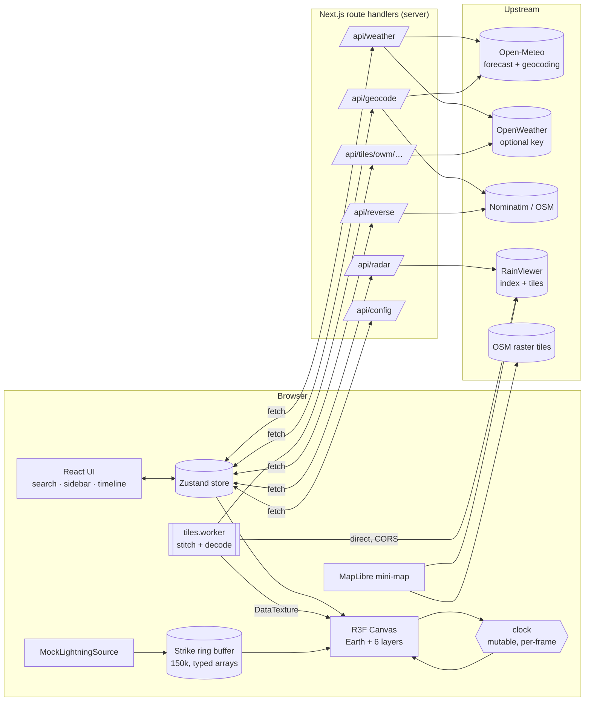
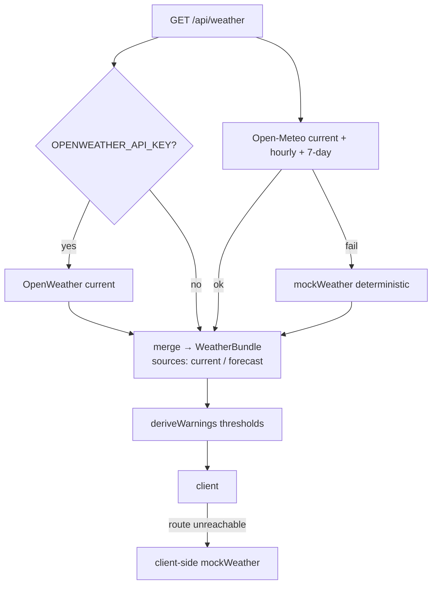
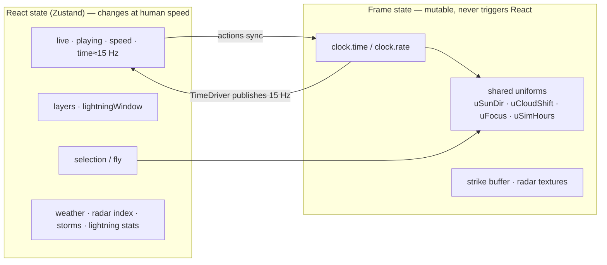

# StormWatch Earth — Architecture

A client-rendered WebGL observatory with a thin server layer that proxies, normalises and caches
third-party weather data. Every number on screen carries its source, so you can always tell live
observations from modelled or simulated data.

## 1. System diagram



**Why proxy some calls and not others?**

| Call | Path | Reason |
|---|---|---|
| Weather, geocoding, reverse | server route | Normalise several providers into one shape, hide the OpenWeather key, set Nominatim's required `User-Agent`, throttle Nominatim to 1 req/s, use Next's data cache |
| RainViewer index | server route | 60 s cache in front of the API |
| RainViewer tiles | browser → tilecache directly | Served with `Access-Control-Allow-Origin: *` and a 2-day cache. Proxying would only add latency |
| OpenWeather tiles | server route | The key must not reach the browser |

## 2. Provider chain and fallbacks



| Domain | Primary | Fallback | Labelled in UI as |
|---|---|---|---|
| Current conditions | OpenWeather (keyed) → Open-Meteo | Mock | `OpenWeather` / `Open-Meteo` / `Simulated` |
| Hourly + 7-day | Open-Meteo | Mock | same |
| Warnings | Derived from forecast thresholds | — | `derived` (not official bulletins) |
| Radar (precipitation) | RainViewer, last ~2 h at 10-min steps | Procedural field outside the archive | `RainViewer` / `Simulated` |
| Global clouds | OpenWeather `clouds_new` (keyed) | 4K cloud texture, animated + blended toward observed local cover | `OpenWeather` / `Model` |
| Temperature overlay | OpenWeather `temp_new` (keyed) | Radiative toy model (latitude, season, land/sea, diurnal) | `OpenWeather` / `Model` |
| Wind particles | Zonal-flow + noise model, blended to the observed local wind | — | `Model` |
| Lightning & storm cells | `MockLightningSource` | — | `Simulated` |
| Autocomplete | Open-Meteo geocoder + local gazetteer | Gazetteer | — |
| Full search / reverse | Nominatim | Gazetteer / raw coordinates | — |

### Lightning: why it's simulated

Blitzortung has no public API. Its data is a volunteer network shared over an undocumented
WebSocket, and its terms limit use. The feed therefore sits behind an interface, `src/lib/lightning/source.ts`:

```ts
interface LightningSource {
  start(): void; stop(): void;
  setFocus(p: LatLon | null, thunderRisk: number): void;   // forecast → simulation hint
  stormCells(t: number): StormCell[];
}
```

`MockLightningSource` models a storm climatology. It seeds systems per hour in 17 convective hot spots and
weights them by season. Each system drifts with the prevailing flow and peaks in the local afternoon.
When the selected place's forecast shows thunder or high CAPE, the source parks a local cell nearby.
To use a real feed, implement the interface for a licensed one (Blitzortung by agreement,
Vaisala/Xweather, Earth Networks, or NOAA GLM via a relay) and swap the class in `useLightningFeed`.

## 3. Component hierarchy

```
app/page.tsx (server)
└─ ClientRoot (client-only boundary, ssr:false)
   └─ StormWatchApp ─ useBootstrap · useWeatherSync · useLightningFeed
      ├─ GlobeCanvas  (R3F <Canvas>, lazy chunk)
      │  ├─ PerformanceMonitor                  adaptive resolution (dpr 1…2, fixed MSAA)
      │  ├─ TimeDriver                            advances clock, updates shared uniforms
      │  ├─ Stars
      │  ├─ <Suspense>
      │  │  ├─ Earth                              day/night, relief, ocean glint, cloud shadows
      │  │  ├─ TemperatureLayer   r=1.002         ┐
      │  │  ├─ PrecipitationLayer r=1.0045        │ each: useLayerFade → lazy-mount,
      │  │  ├─ SnowfallLayer      r=1.005         │
      │  │  ├─ CloudLayer         r=1.007         │ fetch on first enable, fade in/out
      │  │  ├─ Graticule                          │
      │  │  ├─ WindLayer          (CPU particles) │
      │  │  ├─ StormLayer         (cell glyphs)   │
      │  │  ├─ LightningLayer     (GPU points)    ┘
      │  │  ├─ LocationMarker                     radar-lock reticle + <Html> label
      │  │  └─ Atmosphere                         analytic limb scattering
      │  └─ CameraRig                             direct-manipulation drag/zoom (Watched-style), fly-to, idle drift, picking
      ├─ TopBar · LayerRail · Hud (legends, cursor, altitude)
      ├─ SearchPanel                              autocomplete, coords, geolocation
      ├─ Sidebar
      │  ├─ GlobalOverview         (no selection)
      │  └─ Summary (+ LocalRadarMap, MapLibre, lazy) · Events · TimelineSection · Forecast
      ├─ ForecastDeck                             current · 24 hourly cards · 48 h chart · 7-day cards (main view)
      ├─ TimelinePlayer                           24 h scrubber, strike histogram, radar coverage
      ├─ MarkerLabel                              DOM tag positioned by LocationMarker each frame
      ├─ Landing                                  welcome hero, search, chips, click-to-pin, live corner readouts
      ├─ ShareDialog                              forecast card (canvas) · copy image · save PNG · link
      └─ AboutDialog                              "How this works" overlay (? key), section index + scroll spy
```

Desktop (≥1024 px): left rail, right sidebar and a full-width bottom timeline. The camera's
`setViewOffset` centres the globe in the space left of the sidebar. Mobile: the search and a horizontal
layer strip sit on top, the timeline is compact, and the sidebar becomes a bottom sheet.

### Entry flow and layout

`Landing` sits above the canvas while textures, radar, lightning and config load. The planet turns to the right of
the hero (or above it on phones) and can be dragged; a click drops a pin. Choosing a place selects it, then `enter()` flips `entered`, and `CameraRig` flies in toward the remembered place
(`localStorage`) or the viewer's longitude. Desktop layout, top to bottom: layer chips, the globe (its view offset centres it in
the space left of the sidebar and above the deck), `ForecastDeck` (about 38% of the height, collapsible), then the full-width timeline.

## 4. State management



Rules that keep the frame rate high:

1. **Nothing animates through React.** `clock` and the `shared` uniforms are plain mutable objects
   that `TimeDriver` updates once per frame. Every material references the same uniform objects.
2. **The store gets coarse mirrors only.** Timeline time is published at about 15 Hz for the
   scrubber and clocks. Lightning stats and storm cells update at 1 Hz.
3. **Any action that moves the playhead** (`play`, `seek`, `rewind`, `goLive`) writes `clock.time` too,
   so the render loop never disagrees with the UI.
4. **Large data stays outside the store.** Strikes live in a typed-array ring buffer, and only the
   ranges written since the last frame go to the GPU (`addUpdateRange`). Decoded radar frames are
   `DataTexture`s held by `radar` (manager.ts). The store only gets a `radarVersion` counter.

## 5. Rendering pipeline

| Layer | Technique | Cost control |
|---|---|---|
| Earth | Custom shader: 4K Blue Marble + city lights. Sun direction comes from a NOAA subsolar-point formula, so day/night is correct for any timeline time. Relief from a topology gradient, Blinn ocean glint from a water mask, cloud shadows | One draw call, 192×96 sphere |
| Atmosphere | Back-face shell. For each view ray, the closest approach to the planet centre gives an altitude-based glow tinted by the sun, with a sunset band at the terminator | Analytic, no ray-marching |
| Clouds | 4K cloud field with slow domain warp and timeline-driven drift. Near the selection it's blended toward the observed cloud cover with ragged edges. Grey "IR" on the night side | Single texture + 4-octave value noise |
| Precipitation | RainViewer tiles stitched in a **Web Worker** (z1, 512 px → 1024² Web Mercator). Each pixel is decoded from the Universal Blue palette back to **dBZ** (RG8: rain, snow), then recoloured in the shader to the blue/green/yellow/red scale. Frames crossfade, a tent filter smooths the grid, and animated streaks fade out when too small to resolve | Decode off the main thread; 2 MB per frame; frames load newest first |
| Lightning | `THREE.Points` over a 150k ring buffer. Age, flash and window filtering happen in the vertex shader. Flash length is in *real* seconds, so ×1 and ×10 read the same | Partial buffer uploads; back-face culled in the shader |
| Wind | 6.5k (2.6k on mobile) CPU-advected particles drawn as additive line segments | One buffer update per frame |
| Storms | Tangent-plane glyphs: dashed rotating ring, pulse, spiral arms when severe, plus a 2 h dashed track | Minimum on-screen size so cells read from orbit |
| Marker | Single-shader radar-lock reticle (lock-on converge, ticks, sonar pulses), constant screen size | — |

| Snow | Earth shader: seasonal snow / sea-ice cover from the shared `climateTemp` model (latitude vs. season, about 6.5 °C/km lapse rate from the topology map, colder winter interiors). `SnowfallLayer`: RainViewer's snow channel combined with simulated precipitation wherever the model is below freezing, plus twinkling flakes | Same model as the temperature overlay, so the layers always agree |
| Post | `EffectComposer`: mipmap bloom (glints, sun, lightning, limb) and vignette. The Earth shader does its own ACES tone mapping; overlays write linear colour plus `<colorspace_fragment>`, so the result looks the same with or without the composer | Dropped by `PerformanceMonitor.onFallback` |

| HD | 4K day/night/clouds plus a 4K data map (R = relief, G = ocean mask) on first paint; the 8K day map swaps in after entry on desktops (`maxTextureSize ≥ 8192`). The **context patch** is a 720 km NASA GIBS Blue Marble square (1536 px, ~0.47 km/px) around the selected place, sampled with `textureGrad`. It keeps the global map's tone at about 60 km (`textureLod`) and adds only the patch's finer detail, feathered at the edges. `uOrbitFade` thins the coarse global cloud layer and its shadows on close views | One extra texture per place; fades in once bound |

Performance (audited November 2026, Apple M3, 1440×900 at 2× density, production build):

- **Pixel density** starts at the screen's own, at most 1.5, and `PerformanceMonitor` steps it between 1 and
  min(2, device) to hold 45–58 fps. MSAA is fixed for the session, so a step never rebuilds the composer.
- **No hitches from big textures.** The 8k day map and the GIBS patch are decoded off the main thread
  (`ImageBitmapLoader`); the 8k map is then copied to the GPU in 256-row slices, one per frame, with mipmaps built once
  (`Earth.tsx`). Before: a 0.6–1.3 s freeze after entering or on the first zoom.
- **No hitches from layers.** `LayerGroup` compiles a layer's shaders with `compileAsync` while it stays hidden, and
  stops drawing it once it has faded out. Before: turning Temperature on froze the page for 1.2 s.
- **Camera** (`CameraRig.tsx`): Watched-style direct manipulation. The surface follows the pointer at any zoom,
  throws coast with inertia (τ 0.32 s), and wheel and pinch zoom ease in log altitude (τ 0.12 s). Listeners only
  accumulate input; the frame loop applies it. Altitude and hover reach React a few times a second at most.

| Frame time (avg / worst) | Before | After |
|:--|:--|:--|
| Idle | 67 / 283 ms | 23 / 68 ms |
| Drag | 46 / 250 ms | 24 / 65 ms |
| Zoom | 56 / 1,334 ms | 26 / 68 ms |
Layers mount only on first enable, the globe bundle and MapLibre are separate lazy chunks, picking
uses an analytic ray–sphere test (no mesh raycasting), and textures are served `immutable`.

## 6. API surface

| Route | Query | Returns | Cache |
|---|---|---|---|
| `GET /api/weather` | `lat, lon` | `WeatherBundle` | upstream 10 min · client 2 min |
| `GET /api/geocode` | `q, mode=suggest\|search` | `{ places: Place[], source }` | 1 day |
| `GET /api/reverse` | `lat, lon` | `{ place: Place \| null, source }` | 1 day, throttled |
| `GET /api/radar` | — | `RadarIndex` (`host`, `frames[]`) | 60 s |
| `GET /api/tiles/owm/:layer/:z/:x/:y` | — | PNG (needs key, z ≤ 6, layer allow-listed) | 10 min |
| `GET /api/config` | — | `{ openweather, lightningSource }` | — |

Types for all of these live in `src/types/weather.ts`.

## 7. Directory map

```
src/
  app/                 layout, globals.css (design tokens), page, api/*
  components/
    globe/             R3F scene: layers, shaders/common.ts, uniforms.ts, CameraRig, TimeDriver
    ui/                panels, sidebar sections, icons, primitives
  hooks/               useDataFeeds (bootstrap, weather, lightning), useMediaQuery
  lib/
    server/            provider adapters (server-only)
    radar/             manager, palette + decoder, OWM loader, worker client
    lightning/         ring buffer, mock climatology, LightningSource
    mock/              deterministic weather
    geo, sun, format, gazetteer, warnings, weatherCodes, actions
  store/               Zustand store + frame clock
  workers/             tiles.worker.ts
public/textures/       4K Earth textures (from three-globe, MIT)
```

## 8. Next steps

- **Real lightning**: a licensed feed behind `LightningSource`, streamed through a server-sent events route.
- **Higher-zoom radar**: when the camera is under about 3,000 km altitude, stream z3–z5 tiles for the visible region into a second texture.
- **Radar history beyond 2 h**: RainViewer only keeps about 2 h. Archive frames server-side (cron → object storage) to cover the full 24 h timeline with real data.
- **Official alerts**: MeteoAlarm (EU), NWS (US) and JMA feeds next to the derived warnings.
- **8K/16K textures**: ship KTX2-compressed versions and pick a size by GPU tier.
